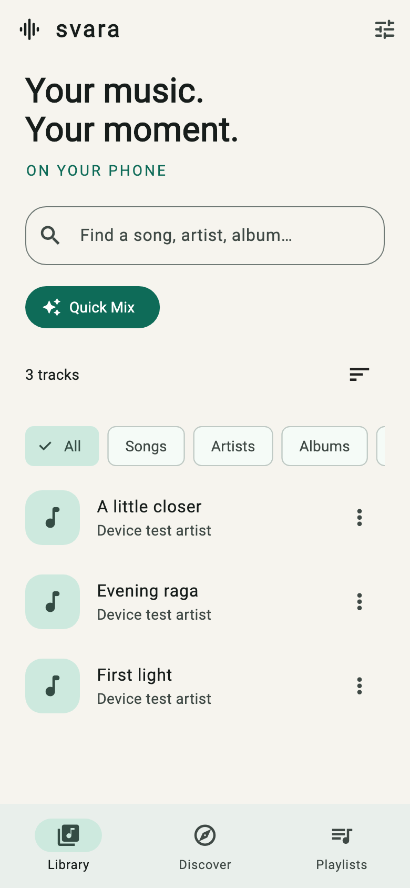
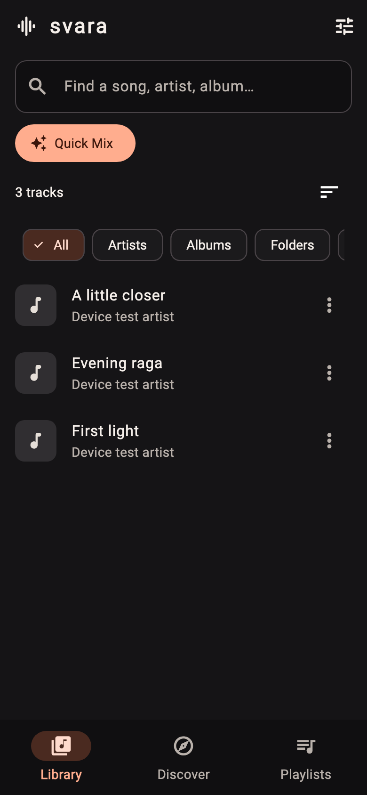
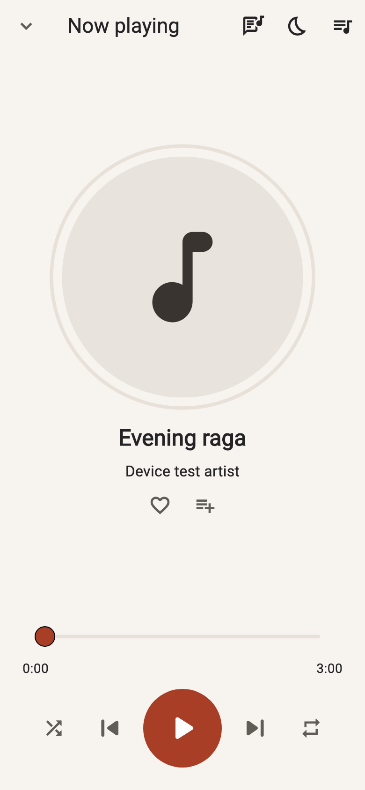
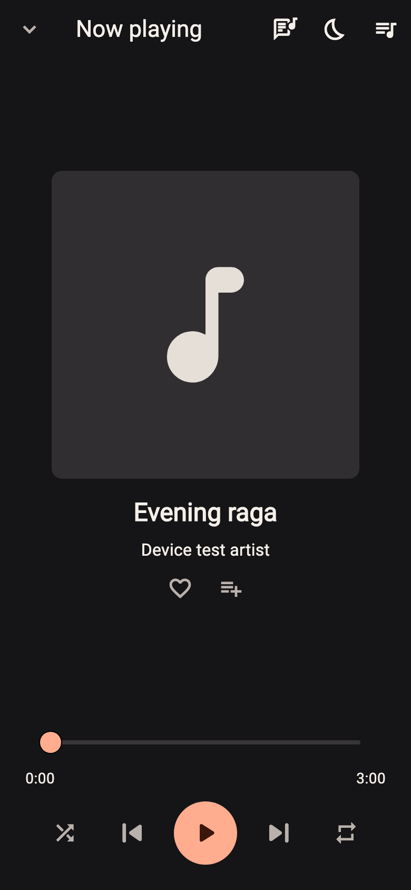

# Svara

An Android music player for your phone’s music, with Audius streaming and experimental YouTube discovery. Built with Flutter and Material 3.

Svara (स्वर) means “musical note” or “voice.” The app has no ads, required accounts, subscriptions, or analytics. Local playback works offline; discovery and online lyrics require an internet connection.

|                                         Library · Light                                          |                                            Library · Dark                                            |
| :----------------------------------------------------------------------------------------------: | :--------------------------------------------------------------------------------------------------: |
|  |  |

|                                      Now playing · Light                                      |                                        Now playing · Dark                                         |
| :-------------------------------------------------------------------------------------------: | :-----------------------------------------------------------------------------------------------: |
|  |  |

## Start here

- **Listeners:** [Install the app](#install-the-app), then follow [Using Svara](#using-svara).
- **Developers:** Follow [Development setup](#development-setup), then [Checks and tests](#checks-and-tests).
- **Having trouble?** See [Troubleshooting](#troubleshooting).
- **Preparing a release?** See [Build-and-release instructions](#build-and-release-instructions).

## What the app does

- Finds audio indexed by Android’s MediaStore and browses it by album, artist, or folder, with search, favorites, and recently played filters.
- Plays local audio through Android’s supported decoders. Common formats include MP3, AAC/M4A, FLAC, WAV, and OGG; compatibility depends on the device and file encoding.
- Offers **Quick Mix**, combining local favorites with less recently played local tracks.
- Searches and streams Audius tracks and experimental YouTube music results.
- Saves playlists and supports Play Next, Add to Queue, queue reordering, shuffle, and repeat.
- Supports background playback, media notification controls, audio interruption handling, and pausing when headphones disconnect.
- Displays synchronized lyrics, plain-text lyrics, and local `.lrc` files.
- Includes light, dark, and system themes, plus a 15-, 30-, 45-, or 60-minute sleep timer.

**Current scope:** Android only. The repository does not include iOS, web, or desktop app targets, a home-screen widget, or an offline download feature for online music. Light mode uses warm ivory surfaces and burnt-orange accents; dark mode uses charcoal surfaces and soft copper accents. Player artwork can tint its progress ring while the app’s navigation and controls keep a consistent palette. Theme colors and component styles are defined in `lib/core/theme.dart`. See [theme design and validation](docs/THEME.md) for the rationale and contrast checks.

## Install the app

Use an APK supplied by a trusted maintainer, or [build one from source](#build-and-release-instructions). The repository’s [Releases page](https://github.com/maadhav-codes/svara-music-player/releases) is the place to check for published builds.

1. Use a device running **Android 7.0 or later (API 24+)** for the documented Flutter 3.47.7 build.
2. Open the APK on your phone. If Android asks, allow the app opening the file to install unknown apps, then complete installation.
3. Open **Svara → Library → Allow music access / Retry** and grant audio access.
4. Tap a song to play it. Use **Discover** for online music and **Playlists** for saved collections.

For separate architecture APKs, `arm64-v8a` is the usual choice for modern phones; `armeabi-v7a` is for older 32-bit ARM devices, and `x86_64` is commonly used by Android emulators. A universal APK includes all supported architectures.

To keep playlists and settings during updates, install an APK with the same application ID (`app.svara`) and signing key and an appropriate version code. Uninstalling or clearing app data removes Svara’s saved data; Android cloud backup is disabled.

## Using Svara

### Your local library

Copy music onto your phone using a file manager or USB transfer. Svara reads Android’s media index rather than importing files into a separate music folder. Return to **Library**, pull to refresh, or use its refresh button after adding or changing music.

Use the filter chips to browse your library, then search or sort the results. Tap **Quick Mix** to start a mix of local tracks. Open a song’s **⋮ Song options** menu to favorite it, add it to a playlist, play it next, add it to the queue, or view file details.

### Playback and gestures

Tap the mini-player to open the full player. The full player provides seeking, previous/next, shuffle, repeat, queue controls, lyrics, and a sleep timer.

| Gesture                                                       | Action                                                                       |
| ------------------------------------------------------------- | ---------------------------------------------------------------------------- |
| Swipe left on the mini-player                                 | Next track                                                                   |
| Swipe right on the mini-player                                | Previous track, or restart the current track after three seconds of playback |
| Swipe up on the mini-player                                   | Open the full player                                                         |
| Swipe down in the full player while its content is at the top | Close the full player                                                        |
| Swipe up on full-player artwork                               | Open lyrics                                                                  |

Downward swipes on the mini-player do nothing. You can also use its Play/Pause and Next buttons. Set a sleep timer from the full player’s **Sleep timer** button; choose **Turn off** to cancel it.

### Playlists

Tap the **heart** in the full player, or choose **Favorite** from a song’s options, to save it automatically in **Playlists → Favorites**. Open Favorites to play all saved songs or choose one to start from. Tap the heart again, choose **Unfavorite**, or use **Remove from Favorites** to remove it. Favorites is a built-in collection and cannot be renamed or deleted. Local and online favorites survive app restarts; online entries save references and still need internet access.

Tap **Add to playlist** beside the heart in the full player, or open a song’s options and choose **Add to Playlist**. Select an existing playlist or choose **New playlist**, enter a name, and save it; the current song is added automatically. Open the **Playlists** tab to play and manage collections, including reordering their tracks.

Saving an online track saves a reference, not an audio file. It still needs internet access and must remain available from its provider.

### Discover online music

Open **Discover** and select **Audius** or **YouTube**. Type a search, or use **Trending Today**, **Top Charts**, **Chill / Lofi**, **Workout**, **Pop**, or **Rock**. Use **Load more** when additional results are available.

Category labels describe shortcuts, not global charts. Audius’s Trending Today uses weekly trending, Top Charts uses monthly trending, and Chill / Lofi, Pop, and Rock use weekly genre rankings. Workout uses search. YouTube categories run suggested music searches. The screen labels the provider and relevant range.

In **Settings → Streaming & Discovery**, you can disable YouTube or choose its audio quality: **Data saver (64 kbps)**, **Standard (128 kbps)**, or **High (256 kbps)**. These are selection targets; the available stream determines the actual format and bitrate. Disabling YouTube stops active YouTube playback and keeps the queue.

YouTube extraction is unofficial and can stop working when the service changes. Restricted, removed, account-required, live, or unsupported videos may not play. Search uses music-oriented metadata filters; it cannot guarantee music-only results or correct recording-artist attribution. A YouTube uploader may be a channel, cover artist, or remixer.

### Lyrics, including offline `.lrc` files

Tap **Lyrics** in the full player or swipe up on its artwork. Synchronized lines follow playback and can be tapped to seek; plain-text lyrics are shown when timed lyrics are unavailable.

For offline lyrics:

1. Place a matching sidecar beside the audio file, such as `My Song.mp3` and `My Song.lrc`.
2. On Android 10+, open that song’s lyrics screen, tap **Choose song folder for .lrc**, and choose the exact folder containing both files. Audio permission alone does not grant access to text sidecars.
3. Refresh lyrics if needed. Repeat the folder selection for songs in other folders or if access is revoked.

A simple UTF-8 `.lrc` file looks like this:

```text
[00:12.00]First line of the song
[00:18.50]Next line of the song
```

The parser supports multiple timestamps per line and `[offset:...]` timing adjustments in milliseconds. Local sidecars are limited to 256 KiB. A usable local file takes priority; otherwise, Svara looks up the song on LRCLIB using title, artist, and, when available, album and duration. Accurate tags help it find the right recording.

## Privacy and stored data

Svara stores its library index, favorites, playlists, settings, listening history, and playback state on the device. **Settings → Clear listening history** removes the history used by Quick Mix. Android cloud backup is disabled with `android:allowBackup="false"`.

Online features contact third parties: Audius, YouTube and their stream/artwork hosts, and LRCLIB. Providers receive requests and normal network information; LRCLIB lookup includes song metadata. Local audio playback itself needs no network connection, but opening lyrics may trigger an online lookup if a local sidecar is unavailable.

The app does not implement persistent downloads or a disk cache for online audio. Search responses, fetched artwork, and online lyrics use bounded session-memory caches. Saved YouTube selections retain identifying titles and uploader labels; saved Audius selections use reference placeholders and refresh metadata at playback. Resolved stream URLs and request headers are not persisted.

Android permissions declared by the app:

| Permission                                                             | Purpose                                                                            |
| ---------------------------------------------------------------------- | ---------------------------------------------------------------------------------- |
| `READ_MEDIA_AUDIO` (Android 13+)                                       | Read the local audio library                                                       |
| `READ_EXTERNAL_STORAGE` (Android 12 and earlier)                       | Read local audio on older Android versions                                         |
| `INTERNET`                                                             | Discovery, streaming, artwork, and online lyrics                                   |
| `WAKE_LOCK`, `FOREGROUND_SERVICE`, `FOREGROUND_SERVICE_MEDIA_PLAYBACK` | Support background playback                                                        |
| `POST_NOTIFICATIONS`                                                   | Playback notifications; visibility also depends on Android’s notification settings |

Local lyrics folder access is granted separately through Android’s system folder picker. The app does not declare camera, microphone, contacts, or unrestricted file-access permissions.

## Development setup

### Prerequisites

The checked-in dependency configuration was generated with **Flutter 3.47.7**. Use that version as the starting point for reproducing builds; newer SDKs may require migration.

| Tool             | Requirement                                                                        |
| ---------------- | ---------------------------------------------------------------------------------- |
| Flutter and Dart | Flutter 3.47.7; `pubspec.yaml` requires Dart `>=3.13.0 <4.0.0`                     |
| Java             | JDK 21 recommended; Java/Kotlin source targets are 17                              |
| Android SDK      | Platform API 36 and the build tools/NDK requested by Flutter and Gradle            |
| Device           | Android phone with USB debugging enabled, or an Android emulator                   |
| Network          | Needed initially for Dart packages, Gradle, Google/Maven repositories, and JitPack |

The app inherits compile, target, and minimum SDK versions from Flutter. Flutter 3.47.7 supplies compile/target API 36 and minimum API 24; the YouTube plugin explicitly uses compile API 36 and minimum API 24. Recheck these values when upgrading Flutter.

### Clone, check tools, and run

```sh
git clone https://github.com/maadhav-codes/svara-music-player.git
cd svara-music-player

flutter --version
flutter doctor -v
flutter doctor --android-licenses
flutter pub get
flutter devices
flutter run -d DEVICE_ID
```

Replace `DEVICE_ID` with an Android device ID from `flutter devices`. Resolve Android toolchain issues reported by `flutter doctor` before running. If Flutter selects the wrong Java installation, configure it with `flutter config --jdk-dir=/absolute/path/to/jdk-21`.

### Optional Audius configuration

The code defaults to `https://api.audius.co` and omits the API key when none is supplied. Provider access or rate limits may still affect requests. To use a registered **public** Audius key:

```sh
flutter run -d DEVICE_ID --dart-define=AUDIUS_API_KEY=YOUR_PUBLIC_API_KEY
```

To override the base URL, add `--dart-define=AUDIUS_BASE_URL=https://YOUR_HOST`. Use an HTTPS endpoint compatible with the repository’s `/v1/tracks/...` requests. Pass the same defines to `flutter build` when preparing an APK. These values are compiled into the client; never use private tokens or secrets.

YouTube uses the local Android plugin and does not require a YouTube API key, Python, Deno, or a hosted backend. LRCLIB lookup has no configurable key in this implementation.

## Codebase guide

```text
lib/
├── main.dart                 # Opens SQLite, creates repositories and audio service
├── svara_app.dart            # Material 3 themes and Library/Discover/Playlists navigation
├── core/                    # Track/source models, Riverpod providers, SQLite, artwork
└── features/
    ├── library/             # Android MediaStore bridge, library filters and song options
    ├── discovery/           # Audius client, YouTube repository, categories and search UI
    ├── player/              # Audio handler, source resolution, queue and player UI
    ├── playlists/           # Playlist persistence and management
    ├── lyrics/              # LRC parsing, LRCLIB lookup and lyrics UI
    └── settings/            # Theme, YouTube configuration, history and licenses
android/app/src/main/
├── AndroidManifest.xml      # Permissions, activity and background audio service
└── kotlin/app/svara/
    └── MainActivity.kt      # MediaStore, local artwork and lyrics-folder access
packages/svara_youtube/      # Dart method channel and native NewPipeExtractor plugin
test/                       # Unit and widget tests
integration_test/           # Live Android YouTube playback smoke test
assets/licenses/            # Bundled software license notices
```

Riverpod wires repositories and app state. SQLite (`sqflite`) holds durable data; Dio handles Audius and lyrics requests. `just_audio` plays audio, `audio_service` exposes background/media controls, and `audio_session` handles audio focus.

`Track.source` identifies local, Audius, or YouTube tracks. `SvaraHandler` owns the logical queue, active index, shuffle, repeat, and persistence. `SourceResolver` resolves the selected reference at playback time, and the audio engine receives one current source. On an online playback failure, the handler attempts one fresh resolution before pausing with queue and position preserved. Gapless transitions and next-track extraction prefetch are not implemented.

The YouTube plugin registers with both foreground and background Flutter engines. Native dependencies are pinned in `packages/svara_youtube/android/build.gradle`: NewPipeExtractor **v0.26.5**, OkHttp **4.12.0**, and NIO desugaring **2.1.5**. Native requests use bounded workers, cancellation, and deadlines; transient repository requests retry at most twice.

YouTube song searches normally keep results between 45 seconds and 20 minutes and exclude likely non-music titles. Explicit mix, album, compilation, concert, or DJ-set searches use music video results and may allow long-form uploads up to four hours. An empty filtered page can still have a continuation. Tests cover this policy in Dart and Kotlin.

## Checks and tests

Run these from the repository root:

```sh
# Check formatting without rewriting files.
dart format --output=none --set-exit-if-changed lib test integration_test packages/svara_youtube/lib

# Analyze Dart code.
flutter analyze

# Run the unit and widget suite in test/.
flutter test
```

The suite covers queue behavior, source resolution, discovery policies, library interactions, lyrics, player layouts, and gestures. Desktop tests use system SQLite through `sqflite_common_ffi`; a missing SQLite shared library must be resolved on the host.

To run the native YouTube search-policy tests on macOS/Linux after Flutter setup:

```sh
cd android
./gradlew :svara_youtube:testDebugUnitTest
cd ..
```

On Windows, use `gradlew.bat` instead of `./gradlew`.

### Live Android smoke test

This separate test needs an Android device, network access, and working YouTube extraction. It is not run by the normal `flutter test` command.

Use a dedicated test device: installation may replace the installed app, and version or signing conflicts may prompt an uninstall. Do not uninstall an installation containing data you need.

```sh
flutter test integration_test/youtube_device_test.dart -d DEVICE_ID

# Allow a longer window to check playback after pressing Home.
flutter test integration_test/youtube_device_test.dart -d DEVICE_ID --dart-define=BACKGROUND_SECONDS=15
```

The test searches Kevin MacLeod music, checks pagination, and uses Blender’s Big Buck Bunny as a muted playback fixture for resolution, decoding, seeking, progression, and saved-reference checks. For background verification, press Home when the log prints `BACKGROUND_READY`, then confirm the test passes. Reinstall the regular app afterward with `flutter run -d DEVICE_ID`; the test APK displays a test harness.

## Build-and-release instructions

```sh
# Development APK.
flutter build apk --debug

# Universal release APK.
flutter build apk --release

# Smaller release APKs, one per architecture.
flutter build apk --release --split-per-abi
```

Build outputs are in `build/app/outputs/flutter-apk/`:

Keep generated APKs in the ignored build output directory. Local distribution APKs and checksum files are not kept in the workspace; `dist/` remains ignored. Flutter also generates the ignored Android `GeneratedPluginRegistrant.java`; it is not a second app implementation.

| Build             | Filename                                                                             |
| ----------------- | ------------------------------------------------------------------------------------ |
| Debug             | `app-debug.apk`                                                                      |
| Universal release | `app-release.apk`                                                                    |
| Split release     | `app-arm64-v8a-release.apk`, `app-armeabi-v7a-release.apk`, `app-x86_64-release.apk` |

Install a universal release on a connected test device with Android SDK’s `adb`:

```sh
adb -s DEVICE_ID install -r build/app/outputs/flutter-apk/app-release.apk
```

Release signing accepts `android/key.properties` for local builds:

```properties
storeFile=/absolute/path/to/svara-release.jks
storePassword=YOUR_STORE_PASSWORD
keyAlias=YOUR_KEY_ALIAS
keyPassword=YOUR_KEY_PASSWORD
```

The file and keystore are ignored by Git. All four values are required together.
Without signing configuration, local release builds use the debug key for
testing. Configure a production signing key before public distribution.
Release mode enables minification and resource shrinking.

Builds, checks, and release publishing are currently manual. CI/CD and GitHub
Actions workflows are not configured; automation will be added later.

Before public distribution:

1. Configure `android/key.properties` with a production keystore. Keep the keystore and passwords outside version control, and preserve the key for future updates.
2. Update `version` in `pubspec.yaml` (`versionName+versionCode`) and the displayed version in `lib/features/settings/settings_screen.dart`. Use a higher build number for upgrades; `--build-number=NUMBER` can override it during a build.
3. Run the checks above, the relevant Android smoke tests, and a minified release build. Confirm local playback, permissions, playlists, notification controls, and lyrics on a device.
4. Manually upload distribution APKs and their SHA-256 checksums to GitHub Releases. Ship corresponding app/plugin source, build instructions, and third-party notices with the distribution.

When updating NewPipeExtractor, review and pin the new version, update `assets/licenses/NOTICE.txt`, and verify native tests, live playback, and release shrinking. Preserve the plugin’s Rhino consumer R8 rules and NIO desugaring in both the app and plugin. The Gradle compatibility flags `android.builtInKotlin=false` and `android.newDsl=false` are currently enabled; revisit them when migrating the Android/Flutter toolchain.

## Troubleshooting

| Problem                               | What to check                                                                                                                                                     |
| ------------------------------------- | ----------------------------------------------------------------------------------------------------------------------------------------------------------------- |
| Library permission denied             | Tap **Allow music access / Retry**, or **Open app settings** and grant audio access.                                                                              |
| Music is missing                      | Confirm the files are on the phone and indexed by Android, then refresh Library. Files hidden from MediaStore, including folders with `.nomedia`, may not appear. |
| A local file will not play            | Check that the file still exists, audio access is granted, and the device supports its encoding.                                                                  |
| Discover fails or returns no results  | Check connectivity and try another query or provider. An empty YouTube page may still offer **Load more**.                                                        |
| YouTube playback fails                | Retry, check that YouTube is enabled, or use local music/Audius. Restrictions or extractor changes may require an app update.                                     |
| Lyrics are missing or incorrect       | Check title/artist tags and recording duration. Add a matching `.lrc` sidecar and grant the exact song folder on Android 10+.                                     |
| Gradle cannot resolve dependencies    | Check access to Google Maven, Maven Central, and JitPack, plus the selected JDK and installed Android SDK.                                                        |
| APK will not update the installed app | Check version code and signing key. Keep the original key; uninstalling to resolve a conflict deletes app data.                                                   |

## License and credits

Svara is **GPL-3.0-or-later**. See [LICENSE](LICENSE) and [native dependency notices](assets/licenses/NOTICE.txt). Third-party notices are also available in **Settings → Open-source licenses**.

Flutter collects Dart package licenses automatically. `lib/core/licenses.dart`
adds the bundled notices for native Gradle dependencies, including the local
NewPipeExtractor plugin and Android desugaring libraries. Keep those notices
alongside the corresponding native dependencies when changing the build.

Music and lyrics come from their respective providers; their availability and permitted use depend on the provider and rights holder. Software licenses do not grant rights to recordings or override provider terms. The experimental YouTube integration is not an official YouTube client.

Created by **Mayur Dayal** — [mayurdayal.engineer@gmail.com](mailto:mayurdayal.engineer@gmail.com).
